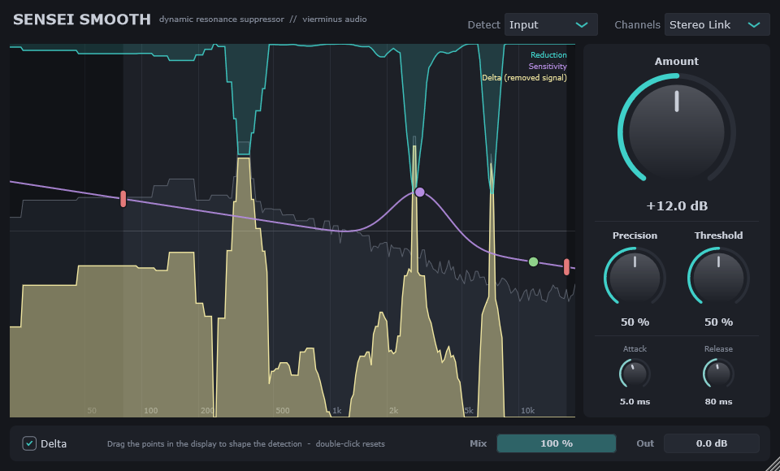

# Sensei Smooth

**Dynamic resonance suppressor by vierminus audio.**

Sensei Smooth is a JUCE-based VST3/Standalone effect that finds harsh, ringing frequencies
and pulls them down only while they stick out, so the rest of the sound keeps its energy.
It can also make room for another track via sidechain.



*Delta view: the yellow area is the signal that is being removed. The teal curve hanging from the top
is the current reduction, and the purple line is the editable detection curve.*

## Current Highlights

- VST3 + Standalone build via CMake (JUCE 8.0.6)
- Spectral (STFT) processing with smooth per-frequency gain, no phase smearing between dry and wet
- **Input mode:** detects resonances relative to the track's own spectrum
- **Sidechain mode:** cuts the track where another signal (e.g. vocals) needs space
- Editable detection curve: drag points for range, emphasis and tilt directly in the display
- Stereo Link, L / R, Mid / Side, Mid only, Side only
- Delta listening with a live spectrum of the removed signal
- Mix and output, latency reported to the host
- Offline DSP test suite and an offscreen GUI snapshot tool

## Quick Start

1. Put Sensei Smooth on the track that sounds harsh (insert, no routing needed).
2. Turn up **Amount** until the harshness calms down.
3. Use **Precision** for narrower or broader cuts, and **Threshold** to decide how much a peak must stick out.
4. Switch on **Delta** to hear (and see) only what is being removed. If you hear musical content there, back off.
5. Shape the detection in the display: pull the purple point up where it should work harder, down where it should leave things alone.

## Controls

**Side panel** (ordered by importance)

| Control | Range | What it does |
|---------|-------|--------------|
| Amount | 0–24 dB | Maximum reduction per frequency. Start here. |
| Precision | 0–100 % | Width of the cuts: 1/3 octave (soft) to 1/24 octave (surgical) |
| Threshold | 0–100 % | Input: how far a peak must stick out (1.5–12 dB). Sidechain: level the sidechain must exceed (−90 to −30 dB, dashed line) |
| Attack | 0.5–100 ms | How fast the reduction reacts |
| Release | 5–1000 ms | How fast it lets go |

**Display** (drag points, double-click resets, hover shows the value)

| Point | Controls | What it does |
|-------|----------|--------------|
| Red pills | Low / High (20 Hz–20 kHz) | Processing range, with half-octave fades |
| Purple point | Emphasis freq + amount (100 Hz–12 kHz, ±12 dB) | More or less sensitivity around one frequency |
| Green point | Tilt (±3 dB/oct around 1 kHz) | Shifts sensitivity towards lows or highs |

Curve up = more sensitive (more reduction), curve down = less sensitive.

**Header and bottom bar**

| Control | Options | What it does |
|---------|---------|--------------|
| Detect | Input, Sidechain | What the detector listens to |
| Channels | Stereo Link, L / R, Mid / Side, Mid only, Side only | How stereo is processed |
| Delta | on / off | Listen to the removed signal only |
| Mix | 0–100 % | Dry/wet, phase-aligned |
| Out | ±12 dB | Output level |

## Sidechain ("make room")

Put Sensei Smooth on the track that should **make room** (e.g. guitar) and feed the track that
**needs room** (e.g. vocals) into the sidechain. The guitar is cut only in the bands where the
vocal is present (above Threshold) *and* actually competes with it, and only until the vocal
leads by 6 dB. Without a sidechain signal nothing is reduced, and the display shows
"No sidechain signal".

In FL Studio:

1. Select the vocal mixer track, right-click the routing arrow of the guitar track and choose **Sidechain to this track**.
2. In Sensei Smooth's wrapper (gear icon) → **Processing**, assign that track to the plugin's **Sidechain** input.
3. Set **Detect** to **Sidechain**. The orange sidechain spectrum appears in the display.

## Latency

2048 samples at 44.1/48 kHz (about 43–46 ms), reported to the host so it is compensated automatically.
At 96/192 kHz the FFT grows with the sample rate, so the latency in milliseconds stays about the same.
Fine for mixing, too much for live monitoring.

## Build

Requirements: CMake 3.22+, Visual Studio 2022 (Windows). JUCE 8.0.6 is used from `./JUCE` if present,
otherwise CMake fetches it automatically.

```bash
cmake -B build -G "Visual Studio 17 2022" -A x64
cmake --build build --config Release
```

Outputs:

- `build/SenseiSmooth_artefacts/Release/VST3/Sensei Smooth.vst3` → copy to `C:\Program Files\Common Files\VST3`
- `build/SenseiSmooth_artefacts/Release/Standalone/Sensei Smooth.exe`

## Tests

```bash
build/SenseiSmoothTests_artefacts/Release/SenseiSmoothTests.exe
```

Covers transparency (Amount 0, Mix 0, M/S round trip, odd block sizes), resonance reduction,
untouched noise, delta (processed + delta = original), processing range, threshold, detection EQ,
sidechain (reduction, silence, not connected, below threshold) and all channel modes.

GUI snapshot (renders the editor offscreen with a test signal):

```bash
build/SenseiSmoothSnapshot_artefacts/Release/SenseiSmoothSnapshot.exe out.png [sc|drag|delta]
```

`sc` = sidechain mode with a vocal-like sidechain, `drag` = drags the emphasis point with synthetic
mouse events and prints the result, `delta` = delta view.

## Project Layout

- `Source/ResonanceSuppressor.*`: DSP core (depends only on `juce_dsp`)
- `Source/PluginProcessor.*`: parameters (APVTS), state, buses (main + optional sidechain)
- `Source/PluginEditor.*`: GUI (spectrum view with drag points, side panel, bottom bar)
- `Tests/`: offline DSP tests and snapshot tool
- `docs/`: screenshots

Parameter IDs `depth`, `sharpness` and `selectivity` are kept internally for stability; they are shown
as Amount, Precision and Threshold.
